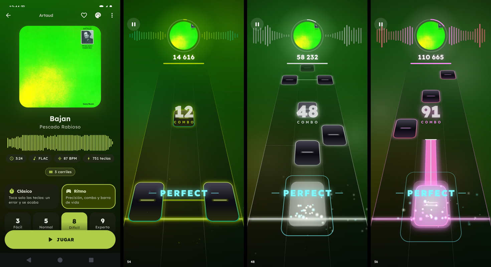
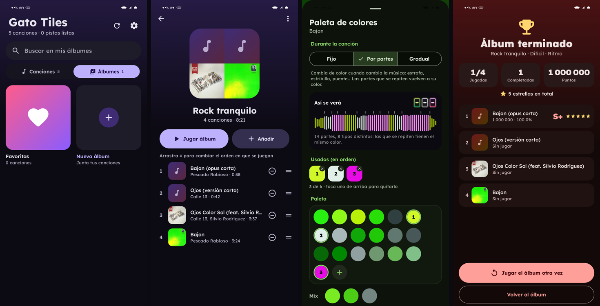

# Gato Tiles

Juego de ritmo para Android con la jugabilidad de Piano Tiles, visuales estilo Beatstar en
partida y una interfaz estilo Namida (Material You con los colores de la portada). Las pistas
se generan automáticamente en el teléfono a partir de **tu música local**: nada de streaming
ni internet.





## Qué incluye

- **Biblioteca local**: lee la música del teléfono (MP3, FLAC, OGG, Opus, M4A/AAC, WAV y los
  demás formatos que decodifique tu Android). Orden, vista previa de la parte más intensa de
  cada canción y búsqueda instantánea (varias palabras, sin importar acentos, resalta lo que
  coincide).
- **Carpetas**: la primera vez la app pregunta dónde está tu música. En *Automático* usa todas
  las carpetas y descarta sola las notas de voz, grabaciones, tonos y audios de WhatsApp o
  Telegram; en *Elegir carpetas* marcas las que quieras en un árbol (se cambia en
  *Ajustes → Carpetas*).
- **Álbumes**: junta canciones en tus propios álbumes (y en *Favoritas*, con el corazón de cada
  canción). Se crean en la pestaña *Álbumes* de la biblioteca o desde una canción (menú ⋮ o
  manteniendo presionada la canción en la lista); el orden se cambia arrastrando. **Jugar
  álbum** juega todas las canciones una tras otra (en orden o aleatorio), con botón
  *Siguiente*, opción de seguir sola tras una cuenta atrás y un resumen final. Mientras juegas
  una canción se prepara la pista de la siguiente.
- **Paleta de colores por canción** (botón de la paleta en la canción): los colores de la
  portada, mezclas y colores propios (botón +), como en Namida. El color de la partida puede
  ser *Fijo*, *Por partes* (cambia cuando cambia la música: estrofa, estribillo, puente...; las
  partes que se repiten vuelven a su color) o *Gradual* (se transforma poco a poco hasta el
  final). La vista «Así se verá» muestra la canción entera con sus colores. El modo por defecto
  de todas las canciones se elige en *Ajustes → Color durante la partida*.
- **Generador de pistas**: analiza cada canción una sola vez (unos segundos) y crea 4
  dificultades: Fácil, Normal, Difícil y Experto, con un nivel numérico (1–15) que tiene en
  cuenta la densidad media, los picos y las ráfagas rápidas.
- **Dos modos**:
  - *Clásico*: como Piano Tiles. Tocas las teclas; tocar fuera o dejar escapar una tecla
    termina la partida. Hay estrellas por avance y coronas por precisión.
  - *Ritmo*: PERFECT / GREAT / GOOD / MISS, combo, barra de vida y rango (S+ … D).
- **Tipos de tecla**: normales, largas (mantener) y dobles.
- **3 o 4 carriles**: en Ajustes o tocando «4 carriles» en la pantalla de la canción. El ritmo
  es el mismo; con 3 las teclas son más anchas.
- **Vista de pista** 3D (perspectiva real) o plana; se cambia en Ajustes.
- **Velocidad variable** (*Ajustes → Velocidad variable*: No / Suave / Intensa): las teclas
  caen más rápido en las partes más movidas de la canción (estribillos, clímax) y vuelven a tu
  velocidad en las tranquilas. Cada parte se mide por su volumen y por cuántas teclas tiene;
  el cambio es gradual y empieza un poco antes de la parte nueva. Con *Intensa* llegan a ir
  un 40 % más rápido. Las teclas siempre llegan a la línea en su momento exacto, y las que
  vienen ya se ven más separadas antes de acelerar.
- **Visuales**: portada desenfocada de fondo con auroras de color, disco con la portada que
  late con el ritmo, barras de espectro en tiempo real, teclas neón con el color de la
  portada, partículas, ondas de choque y textos con brillo.
- **Sincronía**: reloj de audio tomado del hardware (`AudioTrack.getTimestamp`), toques con
  su marca de tiempo exacta, pantalla de calibración con metrónomo y desfases manuales.
- **Modo demostración**: el juego toca solo y perfecto. Sirve para comprobar si la pista va
  con la música.

## Instalar en el teléfono

No hace falta root.

Descarga el APK de la última versión en
[Releases](https://github.com/elgatolinux/gato-tiles/releases/latest).

**Opción A (sin cables):** abre `GatoTiles-0.4.0.apk` en el teléfono y acepta instalar desde
orígenes desconocidos. Se instala encima de la versión anterior sin perder récords.

**Opción B (USB):** activa *Opciones de desarrollador → Depuración USB*, conecta el teléfono y:

```sh
~/Android/Sdk/platform-tools/adb install -r GatoTiles-0.4.0.apk
```

La primera vez pide permiso para leer la música. Para que la sincronía sea buena con tus
auriculares, entra en *Ajustes → Calibrar*.

## Compilar

Requisitos: JDK 17 y Android SDK (plataforma 36). El wrapper de Gradle descarga lo demás.

```sh
./gradlew :app:assembleRelease      # app/build/outputs/apk/release/app-release.apk
./gradlew :app:assembleDebug        # versión de depuración
./gradlew :analyzer:test :app:testReleaseUnitTest
```

La versión release se firma con la clave de depuración para poder instalarla directamente.

## Herramienta de escritorio (probar el generador en el PC)

Usa `ffmpeg` del sistema para decodificar.

```sh
./gradlew :tools:installDist
T=tools/build/install/tools/bin/tools

$T analyze canciones-prueba                     # resumen (con las partes) y JSON de cada canción
$T debug canciones-prueba                       # tempo, ataques, melodía, rejilla (diagnóstico)
$T dump "canciones-prueba/x.flac"               # CSV con ataques, envolvente, beats, melodía, partes y pistas
GT_CANDS=40-45 $T debug "canciones-prueba/x.flac"   # qué ataques de ese tramo se vuelven teclas en Experto
$T preview "canciones-prueba/x.flac" --diff EXPERT --lanes 3   # WAV con un clic por tecla + video MP4
```

Los resultados quedan en `salida/`. El WAV con clics sirve para juzgar la sincronía de oído,
y el video muestra las teclas cayendo con la música.

## Cómo se generan las pistas

1. **Decodificación** con los códecs del sistema y mezcla a mono a unos 22 kHz.
2. **Ataques** con SuperFlux (bandas grave/media/aguda). Cada ataque pesa según cuánto se
   mantiene la energía después, así los clics y el crujido de vinilo cuentan poco.
3. **Tempo y beats**: autocorrelación con preferencia alrededor de 120 BPM, seguidor de beats
   por programación dinámica (Ellis 2007), ajuste lineal por tramos (rejilla exacta en música
   de tempo fijo) y corrección de tempo doble o mitad según el acento. También detecta el
   inicio de compás (bombo + cambio armónico) y el *swing*.
4. **Melodía**: saliencia armónica sobre picos espectrales y Viterbi con estado "sin voz"; el
   resultado se corta en notas alineadas a los ataques.
5. **Intensidad**: la sonoridad por compás regula la densidad de teclas.
6. **Rejilla local**: en cada tramo de la canción se decide si los golpes van en semicorcheas
   rectas o en tresillos (*swing*, *shuffle*, 12/8), y si siguen el pulso o no (rubato, cambios
   de tempo).
7. **Partes de la canción**: vectores por beat de armonía (croma) y timbre (cepstrum), matriz
   de autosimilitud y novedad de Foote para encontrar los cambios de parte, ajustados a la
   línea de compás; las partes que se parecen (misma secuencia de acordes o mismo sonido)
   comparten etiqueta. Se usa para los colores *Por partes*.
8. **Pista**:
   - cada tecla cae en el momento exacto de un ataque o de una nota de la melodía; la rejilla
     solo decide cuánto importa cada uno (tiempo fuerte, contratiempo, semicorchea...), así el
     *swing* y los cambios de tempo conservan su ritmo real;
   - lo que cuenta como «golpe» se mide respecto a la música de alrededor, para que las partes
     suaves también tengan teclas;
   - los compases que se repiten reciben el mismo ritmo;
   - las ráfagas rápidas y regulares (notas repetidas, escalas, trinos) se reconocen aunque
     cada nota suene débil, porque una serie de distancias iguales no aparece por casualidad
     (el crujido de un vinilo es irregular); Difícil las toca completas hasta unas 10 notas
     por segundo y Experto también las más rápidas;
   - las series regulares más lentas (por ejemplo, notas repetidas suaves entre las de la
     melodía) cuentan si tienen al menos 8 notas seguidas sin huecos, para que las partes
     tranquilas de una canción muy dinámica no se queden con pocas teclas;
   - Fácil sigue los tiempos y los golpes más fuertes; Difícil, la mayoría de los ataques
     claros; Experto, casi todos;
   - las largas siguen notas sostenidas y las dobles marcan los acentos más fuertes;
   - el carril sigue el contorno de la melodía (más agudo, más a la derecha), con 3 o 4 carriles;
   - se respetan distancias mínimas para que sea jugable.

## Estructura

```
analyzer/   Kotlin puro: DSP, ritmo, melodía, partes y generador (con pruebas en audio sintético)
app/        App Android (Compose + motor de juego con SurfaceView propio)
tools/      Herramienta de escritorio (analyze / debug / preview)
capturas/   Capturas para este README
```

## Limitaciones conocidas

- Los formatos dependen de los decodificadores del teléfono: APE o WMA normalmente no.
- Una canción se analiza en unos segundos la primera vez; luego queda guardada. Cuando cambia
  el generador (por ejemplo, de la 0.3.0 a la 0.3.1) cada canción se vuelve a analizar una vez.
- En pasajes muy densos y caóticos (como el final de Rush E) no se separan todas las notas:
  la pista sigue las que se distinguen, no cada nota de la partitura.
- Las partes se detectan por el sonido: en canciones muy uniformes (loops, ambient) puede haber
  pocos cambios, y dos partes distintas pero muy parecidas pueden compartir color.
- Las canciones de más de 20 minutos no se analizan.

## Licencia

Gato Tiles es software libre bajo la [GNU GPL v3](LICENSE): puedes usarlo, estudiarlo,
modificarlo y compartirlo, siempre que las versiones que distribuyas sigan bajo la misma
licencia y con su código fuente.

La fuente Lexend Deca se distribuye bajo la
[SIL Open Font License](app/src/main/assets/licenses/LexendDeca-OFL.txt).
